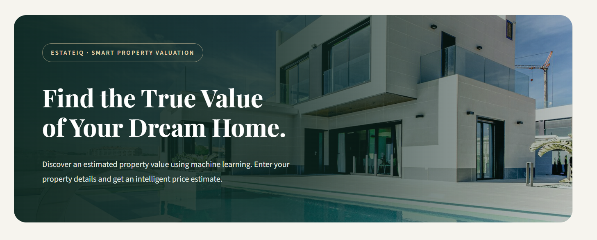
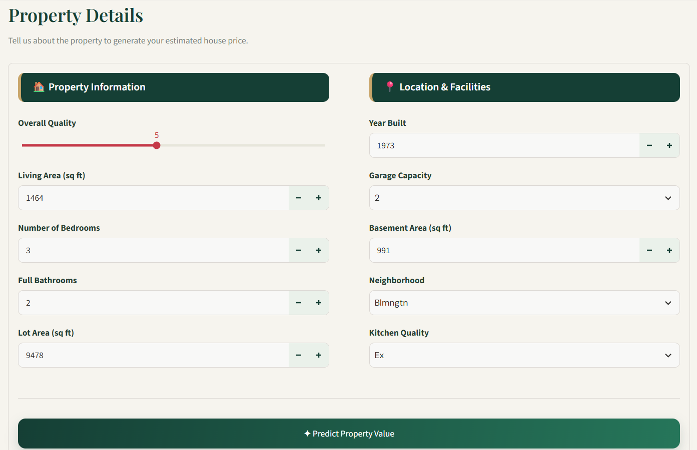
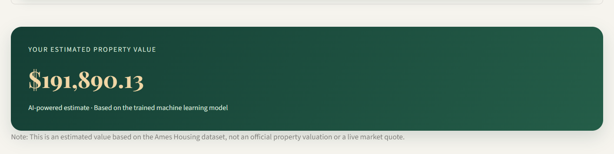
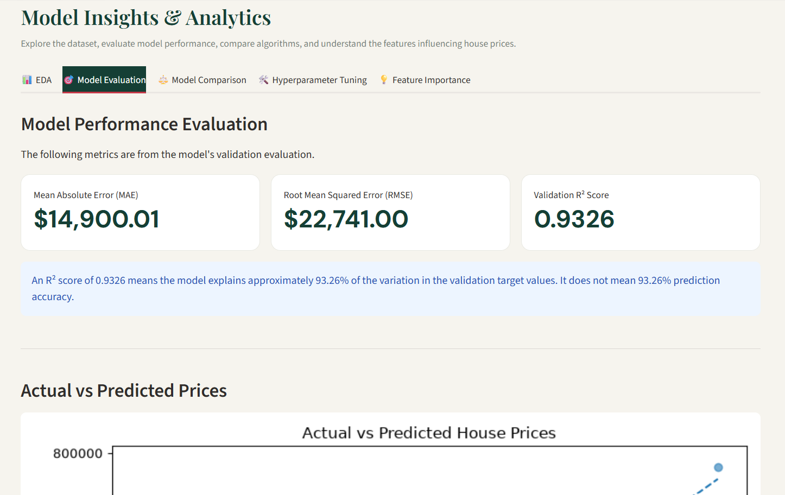
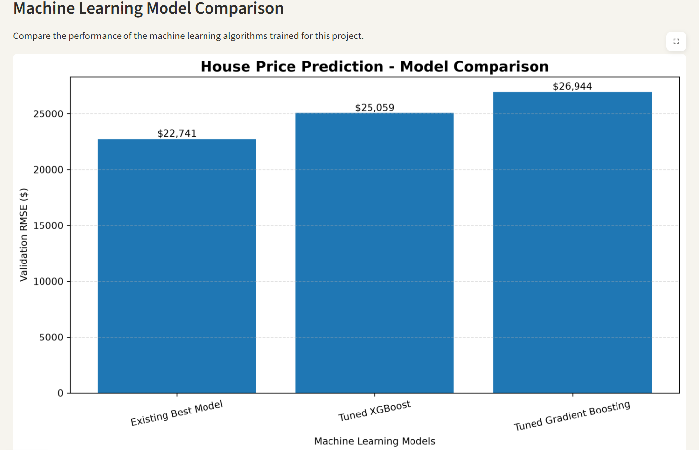
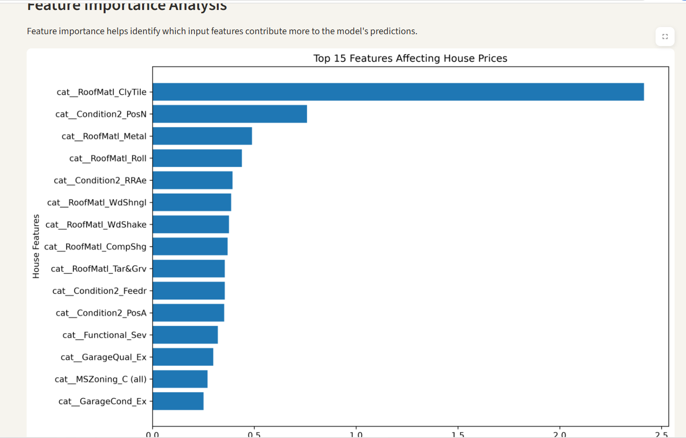
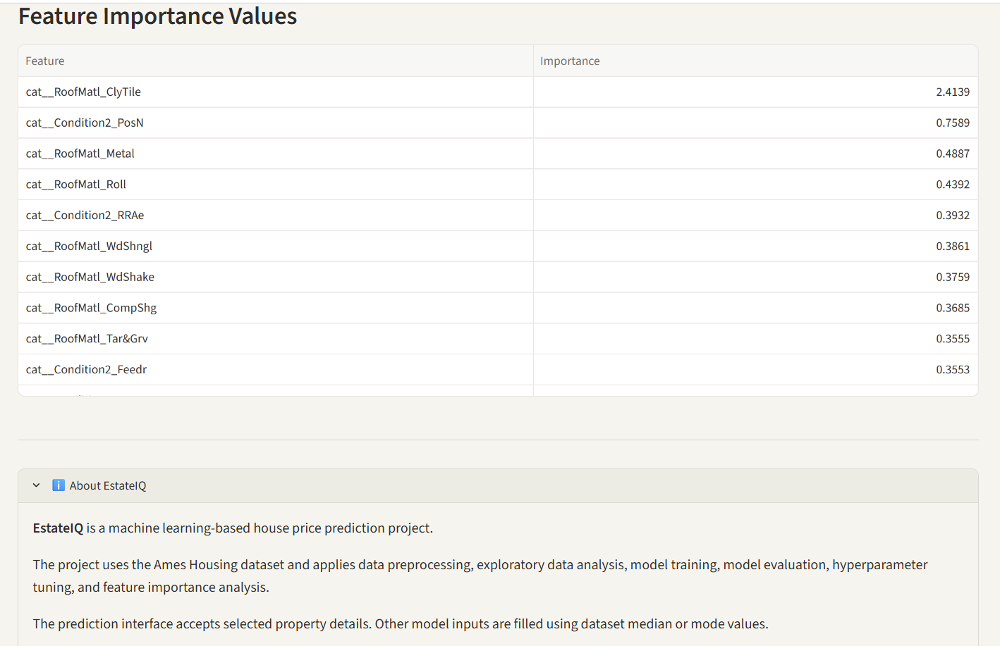

# 🏡 EstateIQ – House Price Prediction

An AI-powered House Price Prediction System built using Machine Learning and Streamlit to estimate residential property prices.

## 🚀 Overview

EstateIQ predicts estimated house prices based on property features such as quality, living area, bedrooms, bathrooms, garage capacity, neighborhood and more.

## ✨ Features

- Exploratory Data Analysis (EDA)
- Data Cleaning and Preprocessing
- Feature Engineering
- Multiple ML Model Training
- Model Evaluation and Comparison
- Hyperparameter Tuning
- Feature Importance Analysis
- Interactive Price Prediction
- Professional Streamlit Web Interface


## Application Screenshots

### 1. Home Page


### 2. Property Input Form


### 3. House Price Prediction


### 4. Model Evaluation


### 5. Model Comparison


### 6. Feature Importance


### 7. Project Overview / Final Dashboard


## 🛠️ Technologies

- Python
- Pandas and NumPy
- Matplotlib and Seaborn
- Scikit-learn
- XGBoost
- Streamlit
- Joblib

## 📊 Model Performance

| Metric | Result |
|---|---:|
| MAE | $14,900.01 |
| RMSE | $22,741.00 |
| R² Score | 0.9326 |

## 📂 Project Structure

```text
House-Price-Prediction/
├── data/
├── notebooks/
├── src/
├── models/
├── reports/
├── app.py
├── README.md
└── requirements.txt
```

## ▶️ Installation and Setup

1. Clone the repository:

```bash
git clone https://github.com/raushanigupta/House-Price-Prediction.git
```

2. Open the project folder:

```bash
cd House-Price-Prediction
```

3. Install dependencies:

```bash
pip install -r requirements.txt
```

4. Run the application:

```bash
streamlit run app.py
```

## 📁 Dataset

House Prices – Advanced Regression Techniques

Source: Kaggle

https://www.kaggle.com/competitions/house-prices-advanced-regression-techniques

Dataset location: Ames, Iowa, USA.

## ⚠️ Disclaimer

The predicted price is an estimate generated by a Machine Learning model and is not an official property valuation.

## 👩‍💻 Developer

**Raushani Gupta**

GitHub: https://github.com/raushanigupta
